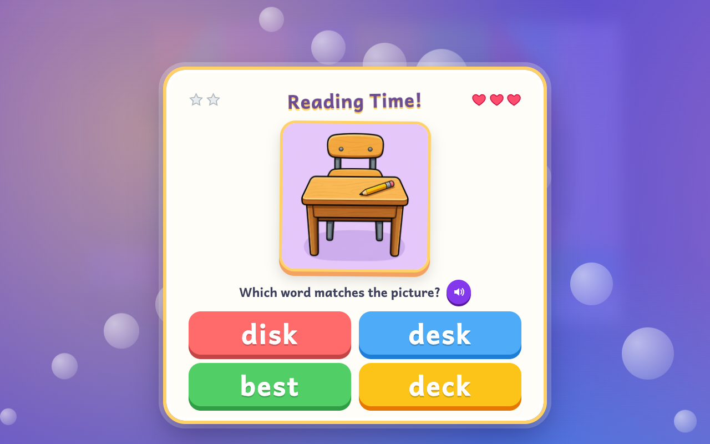

# YouTube Words

A Chrome extension that turns YouTube time into reading practice. After a set amount of YouTube
watching (currently **1 minute**), the video pauses and a colourful quiz slides over the page: a
cartoon picture and four words. Pick the right word to get confetti, balloons and YouTube back.

* Works on Chrome for **Mac and Windows**, installed as an unpacked ("side-loaded") extension.
* Only runs on `*.youtube.com`. Other websites are never touched.
* The words, pictures, sounds and settings come from [`extension/config.conf`](extension/config.conf) on
  GitHub. The extension checks for changes every 30 minutes.
* There are 40 words (5 letters or fewer). Many of them practise letters that are often hard for
  dyslexic readers, such as **b/d** (bed, dog, bear, bread, crab, web), **th** (bath, moth, teeth,
  thumb, three). The wrong answers are look-alike words: *dog / bog / dig / dot*,
  *bed / dab / bad / red*, *three / tree / there / free*.
* It keeps statistics on which words are read correctly, which are missed, and **which words they get
  mixed up with**. Click the toolbar icon to see them.



## How it behaves

| Situation | What happens |
|---|---|
| YouTube is being watched (a visible tab) | Time counts toward the next quiz |
| The time is used up | The video pauses, fullscreen and picture-in-picture are exited, and the overlay animates in |
| Correct answer | Confetti, balloons and "Great job!" are shown and the word is spoken. The padlock opens, the overlay disappears and the video carries on |
| Wrong answer | A sad face, "Oops! Try again — you can do it!" and a heart is lost |
| Three wrong answers | The right word is shown and spoken, then a **new word** comes up. This repeats until one is read correctly |
| `quizzesToUnlock` > 1 | Stars show progress. The answers don't need to be in a row; missed words don't reset progress |
| Quiz takes longer than the interval | That window is skipped; the timer only restarts once YouTube is unlocked |
| A new YouTube tab is opened while locked | It is locked instantly and the video never starts. All tabs share one quiz, and unlocking one unlocks all |
| Keyboard | All YouTube shortcuts are blocked while locked (space, k, f, arrows…) |
| The overlay is deleted with dev tools | It reappears immediately |

## Install (Mac or Windows)

1. Get the code: `git clone https://github.com/RidgebackZulu/youtube-words.git`, or use **Code → Download ZIP** on GitHub and unzip it.
2. In Chrome, open `chrome://extensions`.
3. Turn on **Developer mode** (top right).
4. Click **Load unpacked** and choose the **`extension`** folder inside the project.
5. Pin the extension: click the puzzle-piece icon, then the pin next to **YouTube Words**.

Open YouTube tabs are picked up straight away.

### Making it harder to get around (recommended)

A browser extension can't stop a determined kid who has full control of the computer. These settings
close the easy gaps:

* **Incognito windows**: extensions are off in incognito by default. Either open
  `chrome://extensions` → YouTube Words → **Details** → turn on **Allow in Incognito**, or turn incognito
  off entirely with a Chrome policy:
  * Mac: `defaults write com.google.Chrome IncognitoModeAvailability -integer 1`, then restart Chrome.
  * Windows (admin PowerShell):
    `reg add HKLM\SOFTWARE\Policies\Google\Chrome /v IncognitoModeAvailability /t REG_DWORD /d 1 /f`

  Check that it took effect at `chrome://policy`.
* **Other browsers** (Safari, Edge, Firefox) don't run this extension. Use the OS parental controls to
  block them, or give the child their own computer account that only has Chrome.
* **Disabling the extension or using dev tools**: give the child their own Chrome profile. Optionally
  set the policies `DeveloperToolsAvailability = 2` and `URLBlocklist = ["chrome://extensions"]` the same
  way as above. Remove them when *you* need to change things.

Closing the tab doesn't help the child either: the lock is stored, so the next YouTube tab opens
straight into the quiz.

## The toolbar menu (stats)

Click the extension icon to see:

* **Status**: watching (with a countdown to the next quiz) or locked.
* **Start a quiz now** and **Check for updates** buttons.
* **Word stats**: words read, accuracy and first-try rate, plus each word's ✓/✗ counts and the words it
  was mixed up with. Sort by *Needs practice* or *Known best*.
* **Settings** currently in effect, and when GitHub was last checked.
* A banner when a newer extension version is on GitHub.

Words the child misses more often come up more often.

## `config.conf`

The config lives at [`extension/config.conf`](extension/config.conf). The format is JSON:

```jsonc
{
  "version": 2,                          // bump this when you change pictures/sounds
  "latestExtensionVersion": "1.0.0",
  "settings": {
    "githubCheckIntervalMinutes": 30,     // how often the extension checks GitHub
    "overlayFrequencyMinutes": 1,         // YouTube minutes between quizzes (fractions OK: 0.5 = 30 s)
    "quizzesToUnlock": 1,                 // correct words needed to unlock
    "triesPerWord": 3                     // wrong tries before moving to a new word
  },
  "sounds": { "prompt": "...", "correct": ["..."], "tryAgain": "...", "newWord": "...", "anotherOne": "...", "unlocked": "..." },
  "words": [
    { "word": "dog", "distractors": ["bog", "dig", "dot"],
      "image": "assets/images/dog.webp", "audio": "assets/audio/words/dog.mp3",
      "prompt": "a happy brown puppy dog sitting and wagging its tail" }
  ]
}
```

How updates work:

* Every `githubCheckIntervalMinutes` the extension downloads
  `https://raw.githubusercontent.com/RidgebackZulu/youtube-words/main/extension/config.conf`.
* If anything in it changed, the new settings and word list take effect. Any new pictures or audio are
  downloaded and cached, so they keep working offline.
* If `version` went **up**, every picture and sound is downloaded again. Do this when you redraw a
  picture but keep its file name.
* A config that can't be read is ignored, and the last good one stays in use. Settings are kept within
  safe limits.

### Adding or changing words

```bash
# 1. add an entry to extension/config.conf (word, 3 distractors, image path, audio path, prompt)
# 2. generate its cartoon picture and spoken audio (needs OPENAI_KEY in .env)
npm run generate               # only creates files that don't exist yet
npm run generate -- --only=frog --force   # redo one word
# 3. bump "version" in config.conf, then commit and push
```

The picture prompt always asks for a bright, simple cartoon with **no text or letters**, because a
picture with the word written on it would give the answer away.

### Updating the extension code itself

Chrome doesn't let side-loaded extensions replace their own code, so only words, pictures, sounds and
settings update automatically. When the toolbar menu says there's a new version, run `git pull` in the
project folder (or download the ZIP again), then click the ↻ reload button on `chrome://extensions`.

## Development

```bash
npm install          # Playwright, for the end-to-end test
npm test             # unit tests for the quiz/timer state machine
npm run test:e2e     # loads the real extension in Chromium against a fake YouTube page + fake GitHub
HEADED=1 npm run test:e2e   # same, but watch it
```

Project layout:

```
extension/            ← load this folder in Chrome
  manifest.json
  background.js       service worker: timer, lock state, GitHub updates, stats
  lib/engine.js       pure state machine (unit-tested)
  content.js          the overlay + quiz on youtube.com
  popup.html/js/css   toolbar menu with stats
  config.conf         words / settings (fetched from GitHub)
  assets/             pictures, audio, font (Andika, SIL OFL)
scripts/generate-assets.mjs   makes pictures (gpt-image-2) and speech (gpt-4o-mini-tts)
tests/
```

`.env` holds `OPENAI_KEY`. It is only used by the generator script on the parent's computer. It is
git-ignored and never included in the extension.
